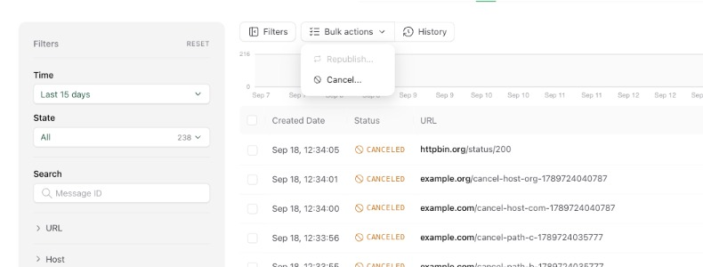
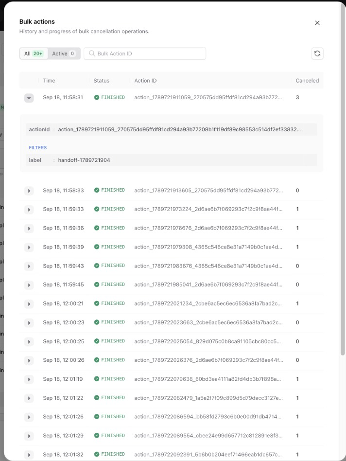

The `Logs` and `DLQ` tabs of the [Upstash Console](https://console.upstash.com/qstash)
let you act on many messages at once. Apply filters to narrow down the list, then
open the **Bulk actions** menu to cancel or republish everything that matches.

<Frame caption="The Bulk actions menu on the Logs tab">
  
</Frame>

## Cancelling matching messages

Cancelling applies to every active message that satisfies the current filters,
including messages that are waiting on a retry. Cancelled messages are removed
without going to the [DLQ](/qstash/features/dlq).

When you cancel a small number of selected messages, the console performs the
cancellation immediately. When you cancel by filter, or cancel all active
messages, QStash processes the request in the background and the console shows
the operation in the bulk action history.

## Bulk action history

The **History** button next to the Bulk actions menu opens a list of every bulk
operation, with its action, state, the filters that were used and how many
messages were processed. Operations still in progress update as they run, and the
`Active` filter shows only those.

<Frame caption="Bulk action history with a finished cancellation expanded">
  
</Frame>

Each entry has an action ID. The toast shown after starting a bulk cancellation
links directly to its entry, and you can paste an action ID into the search box
to find an operation later.

## Acting on DLQ entries

The `DLQ` tab has the same **Bulk actions** menu. It offers **Retry** and
**Delete** for the QStash DLQ, and **Resume**, **Restart** and **Delete** for the
workflow DLQ. The confirmation shows the filters the action will use, and the
history lists DLQ actions next to cancellations.

Selecting rows acts on those entries by their DLQ ID. With no rows selected, the
action uses the filters currently applied to the list, including its time window,
so it covers the entries the list shows and no others: entries that fail into the
DLQ after the list was loaded are left alone. This means **Retry all matching**
and **Delete all matching** cover the list's time window, 15 days by default,
instead of the whole DLQ retention. A filter the action cannot use, such as
**Response Status** on the workflow DLQ, is refused in the confirmation.

Like cancellations, filter-scoped DLQ actions run in the background. The toast
shown after starting one links to its entry in the bulk action history.

## From the API

Bulk cancellation is available through the
[bulk cancel messages](/qstash/api-reference/messages/bulk-cancel-messages) endpoint.
Pass `"async": true` to run it in the background and receive an `actionId` you
can look up with the [bulk actions](/qstash/api-reference/bulk-actions/list-bulk-actions)
endpoints.
