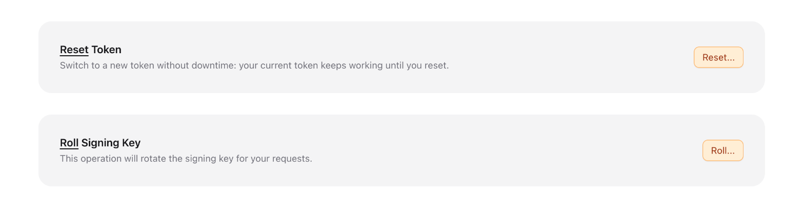
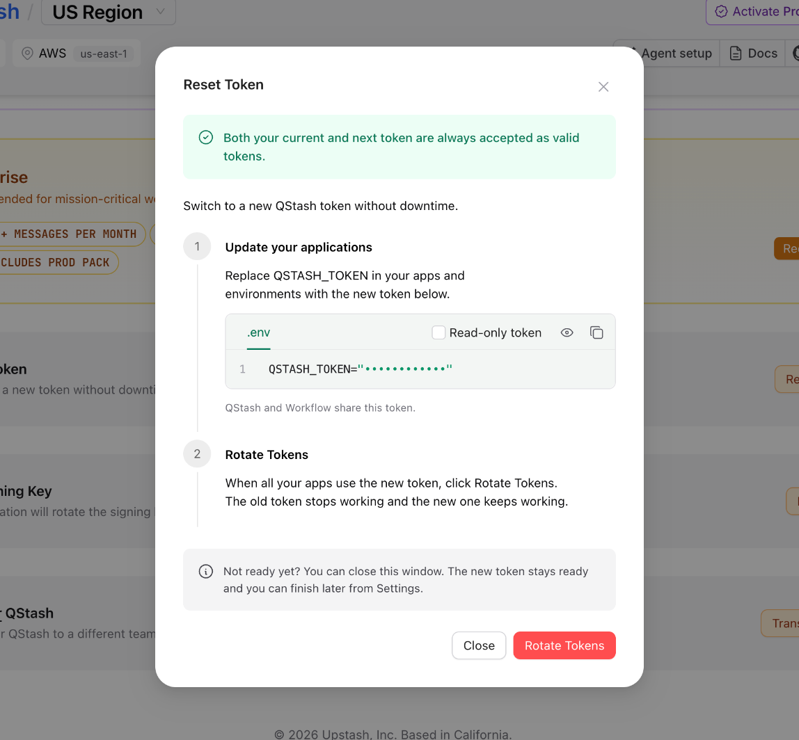

Your token is used to interact with the QStash API. You need it to publish
messages as well as create, read, update or delete other resources, such as
URL Groups and endpoints. QStash and [Upstash Workflow](/workflow/howto/reset-token)
share the same token.

You can switch to a new token without downtime. Every QStash region has a
current token and a next token, and both are accepted. You move your
applications to the next token first, then rotate, and only then does the old
token stop working.

## Reset your token in the console

<Steps>
  <Step title="Open the Reset Token dialog">
    Open your region in the [QStash Console](https://console.upstash.com/qstash),
    go to the **Settings** tab and click **Reset...** on the **Reset Token** card.

    <Frame>
      
    </Frame>
  </Step>
  <Step title="Update your applications">
    The dialog shows your next token. Copy it and replace `QSTASH_TOKEN` in all
    your applications and environments. Check **Read-only token** to get the
    next [read-only token](/qstash/howto/readonly-token) instead.

    Your current token keeps working while you do this, so you can deploy at
    your own pace. You can close the dialog and come back later: the next token
    stays the same until you rotate.

    <Frame>
      
    </Frame>
  </Step>
  <Step title="Rotate tokens">
    Once every application uses the new token, open the dialog again and click
    **Rotate Tokens**. The old token and old read-only token stop working, and
    the new ones keep working.
  </Step>
</Steps>

<Warning>
Click **Rotate Tokens** only after all your applications use the new token.
Requests that still use the old token are rejected after the rotation.
</Warning>

<Note>
If you use QStash through the Vercel Marketplace, the next token is written to
your Vercel project's `QSTASH_TOKEN` when you open the dialog. Vercel does not
redeploy on its own, so redeploy your project before you rotate.
</Note>

## Reset your token with the Developer API

The same flow is available in the [Developer API](/devops/developer-api/introduction):

1. Call [`POST /v2/qstash/next-token/{id}`](/api-reference/qstash/get-the-next-qstash-token)
   to get the next token and read-only token. Calling it again returns the same
   pair until you roll.
2. Update your applications with the next token.
3. Call [`POST /v2/qstash/roll-token/{id}`](/api-reference/qstash/roll-qstash-token)
   with `next_token_hash`, the hex SHA-256 hash of the next token (or next
   read-only token) you deployed. The next pair becomes current and the old
   pair stops working. If the hash does not match the current next token, the
   request is rejected with `409`, so a repeated or stale call cannot retire
   the token you just moved to.

```bash
NEXT_TOKEN_HASH=$(printf '%s' "$NEXT_QSTASH_TOKEN" | shasum -a 256 | cut -d' ' -f1)

curl -X POST "https://api.upstash.com/v2/qstash/roll-token/$QSTASH_ID" \
  -u "$UPSTASH_EMAIL:$UPSTASH_API_KEY" \
  -H "Content-Type: application/json" \
  -d "{\"next_token_hash\": \"$NEXT_TOKEN_HASH\"}"
```

## Reset your token immediately

If your token has leaked, you may want to invalidate it right away instead of
moving your applications over first. [`POST /v2/qstash/rotate-token/{id}`](/api-reference/qstash/reset-qstash-token)
replaces the current token and read-only token at once and discards the next
token. All requests with the old tokens are rejected immediately, so update
your applications right after.
