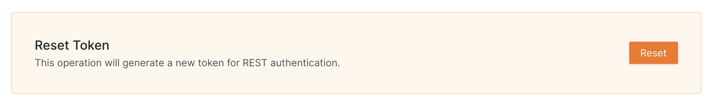

Your token is used to interact with the QStash API. You need it to publish
messages as well as create, read, update or delete other resources, such as
URL Groups and endpoints.

You can reset your token without downtime. QStash accepts both your current
token and the new one until you rotate, so your applications keep working while
you switch over.

To reset your token, click "Reset" next to "Reset Token" in the
[QStash UI](https://console.upstash.com/qstash). The dialog walks you through
two steps:

1. **Update your applications.** Copy the new token and replace `QSTASH_TOKEN`
   in your applications and environments. The dialog also offers a read-only
   variant of the token.

   If you use the Vercel integration, `QSTASH_TOKEN` in your Vercel project is
   already set to the new token. Redeploy before you rotate.

2. **Rotate Tokens.** Click "Rotate Tokens" once all your applications use the
   new token. The old token stops working and the new one keeps working.

You can close the dialog before rotating. The new token stays ready, and you
can finish the rotation later from Settings.

QStash and Workflow share this token.
