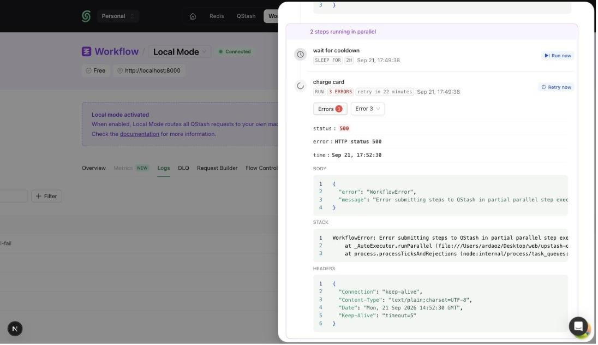

A workflow run can be waiting for three reasons: a step is sleeping because of
`context.sleep` or `context.sleepUntil`, the run itself was started with a
`delay` on [`client.trigger`](/workflow/basics/client/trigger) and its first
request has not been delivered yet, or a step failed and is waiting out its
retry delay before the next attempt. All three can be released early from the
console, so the run continues immediately instead of at the scheduled time.

## From the console

Open the run in the `Logs` tab of the [Upstash Console](https://console.upstash.com/workflow).
Every waiting step shows a button next to its label: **Run now** on a sleeping
step and on a delayed run, and **Retry now** on a step in retry backoff. In a
parallel block, each branch has its own button.

A delayed run's first step is titled **Delayed** and its label reads `runs in …`
until the delay passes. A retrying step keeps the `retry in …` wording.

<Frame caption="A parallel block with a sleeping branch and a retrying branch, each with its own button">
  
</Frame>

The buttons are only offered while the run is still running and the step is
genuinely waiting. Once QStash picks the step up, the button disappears and the
run continues as if the sleep or delay had ended on its own.

<Note>
  Releasing a retrying step does not add an attempt. If the step was on its
  last retry and fails again, the run fails and the
  [failure function](/workflow/howto/failures) is called as usual.
</Note>

## From the API

Under the hood, a sleeping, delayed, or retrying step is a delayed QStash
message. The console calls the
[retry a step now](/workflow/api-reference/runs/retry-a-step-now)
endpoint with the step's message ID, which you can find in the run's
[event logs](/workflow/api-reference/logs/list-workflow-run-logs).

```bash
curl -X POST https://qstash.upstash.io/v2/messages/<STEP_MESSAGE_ID>/retry \
  -H "Authorization: Bearer <QSTASH_TOKEN>"
```
